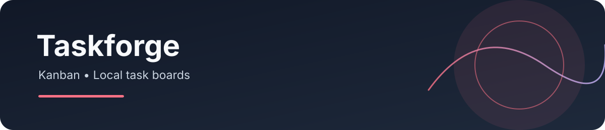

# TaskForge

<p align="center"></p>

A no-account Kanban board that lives in a local SQLite file. Organize work into boards, prioritize tasks and move cards through a simple workflow.

## Features
- To do / Doing / Done columns
- Multiple named boards
- Low, normal and high priority; optional due dates
- Filter by board or status; view all boards
- JSON import/export for portable backups

## Run
Python 3.9+; no installation:

```bash
python app.py add "Build landing page" --priority high --due 2026-12-01 --board website
python app.py add "Review pull request" --board website
python app.py list --board website
python app.py move 1 doing
python app.py move 1 done
python app.py export backup.json
python app.py import backup.json
```

Use `python app.py --help` for all commands. Data is stored in `taskforge.db` beside the script.